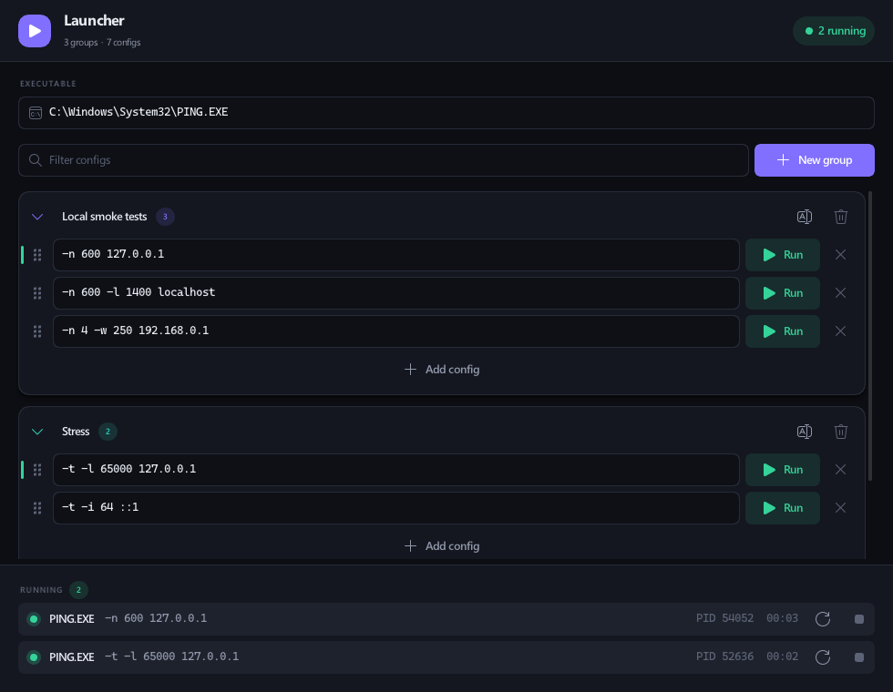

# Config launcher

A small Windows app that runs one executable with different sets of command-line arguments. You save each set of arguments as a config, sort configs into groups, and start any of them with one click.



## Features

- Pick one executable and save as many argument lines (configs) as you need for it.
- Sort configs into named groups. Groups start collapsed and you can rename or delete them.
- Drag a config by its handle to reorder it or move it to another group.
- Type in the filter field to show only configs whose arguments contain that text. Groups with no match are hidden.
- The "Running" panel lists every process started from the launcher with its PID and run time. Each row has a restart button and a stop button.
- Each launch clears the console before the process starts, so you only see output from the current run.

## Requirements

- Windows. The app calls the Win32 API to start and stop processes and loads fonts from `C:\Windows\Fonts`.
- The [Odin compiler](https://odin-lang.org/docs/install/). Raylib and microui come with Odin in `vendor:`, so there is nothing else to install.

## Build

```sh
odin build src -out:launcher.exe
```

## Usage

1. Run `launcher.exe`.
2. Paste the full path of the program to launch in the "Executable" field.
3. Click "New group", then "Add config", and type the arguments for that run.
4. Click "Run" next to a config to start the program with those arguments.

## Saved data

The launcher saves the executable path, groups and configs to `launcher_config.json` in the same folder as `launcher.exe`. It writes the file 500 ms after your last change and again when you close the window. The file is plain JSON:

```json
{
  "exe_path": "C:\\Windows\\System32\\PING.EXE",
  "groups": [
    {
      "name": "Local smoke tests",
      "configs": [
        { "args": "-n 600 127.0.0.1" },
        { "args": "-n 4 -w 250 192.168.0.1" }
      ]
    }
  ]
}
```

`.gitignore` excludes this file.

## Source layout

| File | Contents |
| --- | --- |
| `src/main.odin` | App state, main loop, drag and drop, deferred edits |
| `src/ui.odin` | Layout and widgets |
| `src/launch.odin` | Starting, polling, and stopping processes with Win32 |
| `src/persist.odin` | Loading and saving `launcher_config.json` |
| `src/mu_raylib.odin` | microui renderer and input on top of raylib |
